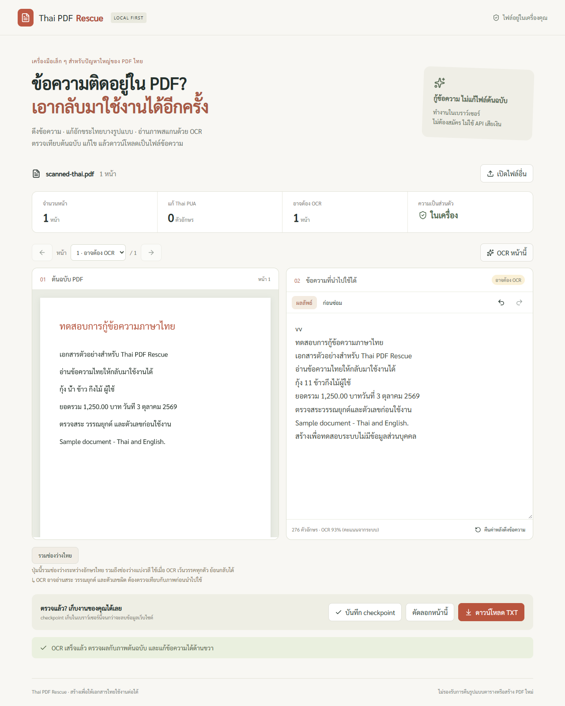

# Thai PDF Rescue

เว็บดึงข้อความจาก PDF ภาษาไทย ซ่อม Thai PUA ที่รองรับ และอ่านภาพสแกนด้วย OCR ไทย + อังกฤษ โดยประมวลผลในเบราว์เซอร์ ไฟล์ต้นฉบับไม่ถูกแก้ไขและไม่ถูกอัปโหลด ไม่มีบัญชีผู้ใช้หรือ API แบบเสียเงิน



## เริ่มใช้

ต้องมี Node.js 24 และ npm เปิด terminal ในโฟลเดอร์ `thai-pdf-rescue`

```powershell
npm ci
npm run assets
npm run dev
```

เปิด [แอปในเครื่อง](http://127.0.0.1:3002) แล้วเลือก PDF หรือลองตัวอย่างบนหน้าแรก รุ่น production:

```powershell
npm run build
npm run start
```

ครั้งแรกต้องใช้อินเทอร์เน็ตติดตั้ง dependencies และดาวน์โหลดโมเดล/ฟอนต์ผ่าน `assets` หลังจากนั้น PDF.js worker, OCR worker, WASM, โมเดลไทย/อังกฤษ และฟอนต์โหลดจากเว็บเซิร์ฟเวอร์นี้เท่านั้น ไม่ใช้ CDN ระหว่างกู้ข้อความ ต้องเปิดเซิร์ฟเวอร์ไว้ ไม่ใช่ PWA ที่เปิดได้โดยไม่มีเซิร์ฟเวอร์

## วิธีใช้งาน

1. เปิด PDF แล้วตรวจภาพต้นฉบับด้านซ้ายกับข้อความด้านขวา
2. เลือกแท็บ **ก่อนซ่อม** เพื่อดูข้อความที่ PDF ให้มา ระบบแทนเฉพาะรหัส Thai PUA ในตาราง WTT เมื่อพบอักษรไทยในหน้านั้น ไม่เดาคำที่หายไป
3. ถ้าเป็นภาพสแกน หรือคัดลอกแล้วอ่านไม่รู้เรื่อง ให้กด **OCR หน้านี้** แก้ข้อความเองได้ คะแนน OCR ไม่ใช่ความแม่นยำที่รับประกัน
4. หาก OCR เว้นวรรคทุกอักษรไทย ใช้ **รวมช่องว่างไทย** ได้ ปุ่มนี้รวมช่องว่างแบ่งวลีด้วย จึงต้องตรวจผล กด undo เพื่อคืนค่า
5. **ดาวน์โหลด TXT** เก็บข้อความทุกหน้าแบบ UTF-8 พร้อมหัวข้อหน้า หรือคัดลอกเฉพาะหน้าปัจจุบัน

รองรับ PDF สูงสุด 20 MB / 60 หน้า และ OCR เป็นชุดสูงสุด 10 หน้า การอ่านภาพจำกัด canvas 5 ล้านพิกเซล PDF ที่มีรหัสผ่านต้องใส่รหัสที่คุณใช้เปิดไฟล์เอง

ชื่อ TXT ใช้ชื่อ PDF ตามด้วย `-rescued.txt` ชื่อยาวจำกัดที่ 100 Unicode code points โดยไม่ตัดอีโมจิขาดครึ่ง แทนอักขระต้องห้ามด้วย `_` ตัดจุด/ช่องว่างท้ายชื่อ และเติม `_` หน้าชื่อสงวนของ Windows เช่น `CON` ตาม [กฎชื่อไฟล์ของ Microsoft](https://learn.microsoft.com/en-us/windows/win32/fileio/naming-a-file) ถ้าชื่อว่างใช้ `document` ชื่อและเนื้อหาไฟล์ต้นฉบับไม่ถูกแก้ไข

## Checkpoint และ rollback

**งานเอกสาร:** ปุ่ม **บันทึก checkpoint** เก็บต้นฉบับกับข้อความปัจจุบันใน IndexedDB ของเบราว์เซอร์นี้โดยสมัครใจ เมื่อ reload สามารถเปิด checkpoint คืนได้ บันทึกได้หนึ่งชุดล่าสุด รหัสผ่าน PDF ไม่ถูกบันทึก ไฟล์เข้ารหัสจะถามรหัสอีกครั้ง ปุ่ม undo/redo ย้อนข้อความได้ 100 ขั้นต่อหน้า และ **คืนค่าหลังดึงข้อความ** คืน baseline ก่อน OCR การแก้ไขหลังบันทึกต้องกดบันทึกใหม่ ไม่ autosave ลบ checkpoint ได้จากแถบด้านบน การล้างข้อมูลเว็บไซต์จะลบ checkpoint

**โค้ดโปรเจกต์:** Git เก็บ checkpoint พร้อม tags แยกจาก checkpoint เอกสาร ก่อนสำรองต้อง commit โค้ดให้เรียบร้อย แล้วรัน:

```powershell
npm run checkpoint -- --label rescue-release
npm run rollback -- --label rescue-release
```

คำสั่งแรกสร้าง ZIP ของ source ที่ commit แล้วและ manifest SHA-256 ใน `checkpoints/` คำสั่งที่สองตรวจ checksum แล้วกู้ลง **โฟลเดอร์ใหม่** `rollback-recovery/` ไม่ reset Git ไม่ลบหรือทับโปรเจกต์ปัจจุบัน รองรับ `tar` ที่มากับ Windows 10/11 หรือ Linux/macOS จากนั้นเข้าโฟลเดอร์กู้คืน ลง dependencies ด้วย `npm ci` แล้ว build ใหม่

สำรอง ref อื่นได้ด้วย `--ref` เช่น `--ref checkpoint/pdf-rescue-release` ZIP ไม่รวม node_modules, โมเดลที่ดาวน์โหลด หรือ .env; สำเนา recovery เป็น source snapshot ไม่มีประวัติ Git

## ทดสอบ

```powershell
npm run verify
npx playwright install chromium
npm run test:e2e
```

หากเครื่องมี Chrome อยู่แล้ว ใช้ `$env:PLAYWRIGHT_CHANNEL='chrome'` บน PowerShell ก่อนรันทดสอบได้ ชุดหลักทดสอบซ่อมอักขระ OCR จริง ไม่มี request ออกนอก origin, undo/redo, checkpoint หลัง reload, ดาวน์โหลด TXT, PDF เสีย/เข้ารหัส, navigation มือถือ และยกเลิก OCR

ทดสอบกับ PDF สาธารณะเพิ่มเติม (ไม่แจกจ่ายไฟล์ต้นฉบับ):

```powershell
node scripts/public-samples.mjs
$env:PUBLIC_PDF_QA='1'
npm run test:e2e
```

GitHub Actions ใน `.github/workflows/ci.yml` ทำ lint, typecheck, unit tests, production build และ browser tests เมื่อเปลี่ยนโปรเจกต์นี้ ผลทดสอบในเครื่องดู [บันทึก QA](docs/QA.md) และ [ขั้นตอนนำขึ้น GitHub](docs/GITHUB.md)

## สถาปัตยกรรมและข้อจำกัด

Next.js + React + TypeScript ให้หน้าเว็บและ static assets, PDF.js อ่านและ render PDF, Tesseract.js ทำ OCR ใน Web Worker ไม่ต้องมีฐานข้อมูลหรือ backend สำหรับประมวลผลเอกสาร จึงลดค่าใช้จ่ายและไม่ต้องเก็บเอกสารผู้ใช้บนเซิร์ฟเวอร์ แต่ความเร็ว/หน่วยความจำขึ้นกับเครื่องผู้ใช้

ผลลัพธ์เป็น **ข้อความ** ไม่ใช่การซ่อมโครงสร้าง PDF หรือคืนเลย์เอาต์ ตาราง/คอลัมน์อาจผิดลำดับ ไม่รองรับ handwriting หรือรับประกัน OCR ที่ถูกทุกตัว ตัวอักษรเสียจาก encoding อื่นนอกตาราง PUA ต้องใช้ OCR/ตรวจเอง ระบบแจ้ง unknown PUA/U+FFFD ได้ แต่ไม่สามารถตรวจทุกกรณีที่เป็นตัวอักษรปกติแต่มีความหมายผิด เอกสารที่มี font mapping สมบูรณ์มักไม่ต้องซ่อม

หน้าเว็บไม่มี telemetry หรือ analytics ตัว server ยังมี HTTP access logs ตามผู้ให้บริการเมื่อ deploy อย่าเพิ่มระบบอัปโหลด/analytics ที่เก็บเอกสารโดยไม่แจ้งผู้ใช้ หากนำขึ้น Vercel ให้เลือก Root Directory เป็นราก repository นี้ ใช้ build `npm run build` ไม่ต้องตั้ง secret หรือเชื่อมฐานข้อมูล ยังไม่ได้ deploy เว็บไซต์ภายนอก

## แหล่งที่มาและสิทธิ์

- [PDF.js](https://mozilla.github.io/pdf.js/) — Apache-2.0
- [Tesseract.js](https://github.com/naptha/tesseract.js) และ [โมเดลภาษา](https://github.com/naptha/tessdata) — Apache-2.0
- [Sarabun](https://github.com/google/fonts/tree/main/ofl/sarabun) — SIL Open Font License; asset script ดาวน์โหลด `OFL.txt` ไว้ข้างฟอนต์
- [ตาราง Thai shaping / WTT](https://linux.thai.net/~thep/th-shape.html) — ใช้อ้างอิง mapping ไม่อ้างว่าแก้ PDF ไทยทุกแบบ

ไฟล์ใน `public/samples/` สร้างขึ้นเพื่อโปรเจกต์นี้ ไม่มีข้อมูลบุคคล ใช้ฟอนต์ Sarabun ที่อนุญาต embedding สร้างใหม่ได้ด้วย Python reportlab, pypdf, pypdfium2 ผ่าน `scripts/make-fixtures.py` ตัวอย่าง PUA ปรับ ToUnicode ของฟอนต์เท่านั้น ภาพต้นฉบับยังเหมือนเดิม โมเดลและฟอนต์ล็อก SHA-256 ใน `assets-lock.json`; ห้าม refresh lock เพียงเพื่อข้ามข้อผิดพลาดโดยไม่ตรวจ upstream
